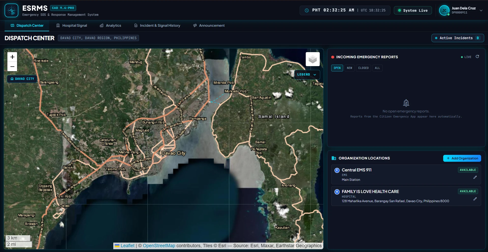
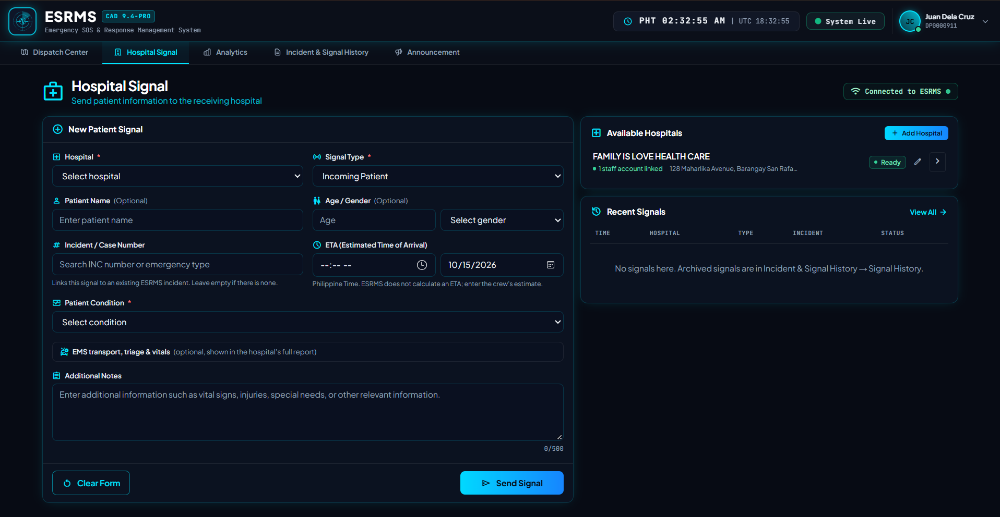
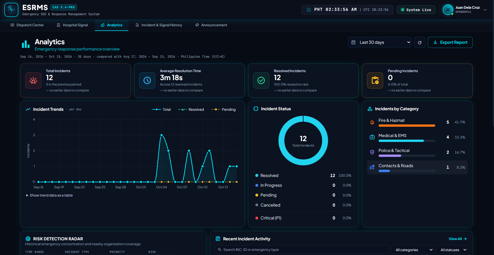
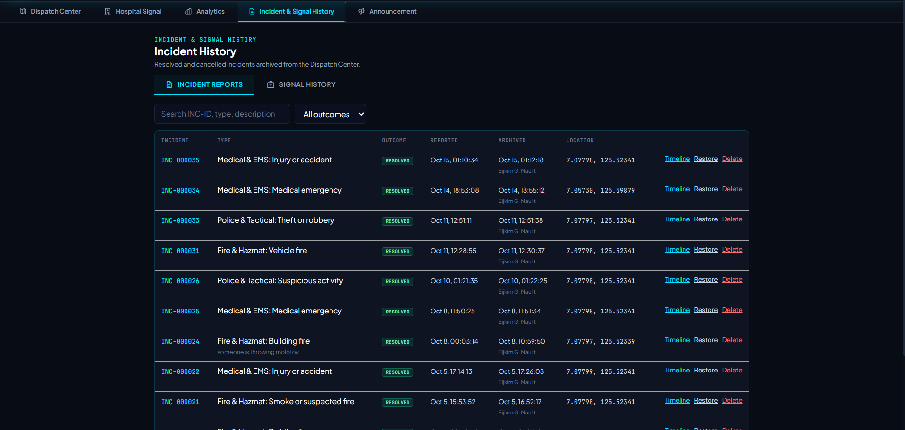
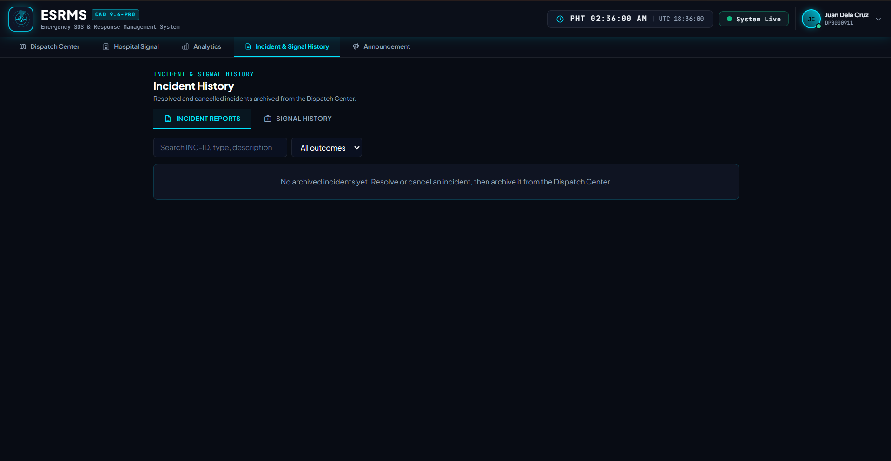
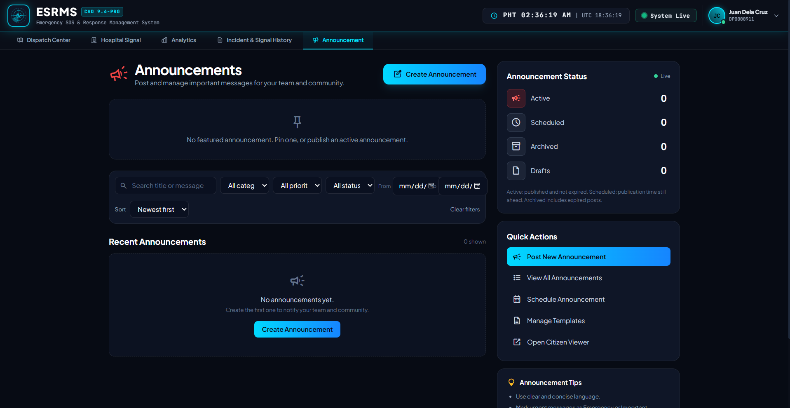

# ESRMS — System Screens and Explanations

Every ESRMS screen shares the same **header**. It shows the ESRMS logo and version (CAD 9.4-PRO),
a live clock in Philippine Time (PHT) and UTC, a **System Live** indicator that confirms the
connection to the server, and the signed-in user's profile menu (name and dispatcher ID). The
**navigation bar** below it switches between the five main modules: Dispatch Center, Hospital
Signal, Analytics, Incident & Signal History, and Announcement.

---

## Figure 1. Dispatch Center

The Dispatch Center is the main working screen for dispatchers. It covers Davao City, Davao Region, Philippines.

- **Live Map (left):** A satellite map (Leaflet / OpenStreetMap / Esri) of the coverage area.
  Incidents reported from the Citizen App appear here as markers at the reporter's GPS location.
  Zoom controls, map layers and a legend sit on the map.
- **Active Incidents counter (top right):** How many emergencies are currently open.
- **Incoming Emergency Reports:** A real-time list of reports sent from the Citizen Emergency App.
  Filters: **Open**, **New**, **Closed**, **All**. New reports appear automatically, without a page refresh.
- **Organization Locations:** The registered response organizations and their bases, for example
  *Central EMS 911* (EMS) and *Family Is Love Health Care* (Hospital), each with its availability
  status (Available). Dispatchers can add or edit organizations. ESRMS uses these bases to suggest
  the nearest suitable responder for each incident.

---

## Figure 2. Hospital Signal

Dispatchers use Hospital Signal to warn a receiving hospital that a patient is on the way.

- **New Patient Signal form:**
  - **Hospital\*** – the receiving hospital.
  - **Signal Type\*** – for example *Incoming Patient*.
  - **Patient Name / Age / Gender** – optional patient details.
  - **Incident / Case Number** – links the signal to an existing ESRMS incident (INC number).
  - **ETA** – the estimated arrival time given by the ambulance crew (Philippine Time).
  - **Patient Condition\*** – how serious the patient's condition is.
  - **EMS transport, triage & vitals** – optional clinical details for the hospital's full report.
  - **Additional Notes** – free text, up to 500 characters (vital signs, injuries, special needs).
  - **Clear Form** / **Send Signal** buttons.
- **Available Hospitals:** Registered hospitals, their status (*Ready*), address and linked staff accounts.
- **Recent Signals:** The latest signals with time, hospital, type, incident and status. The hospital
  updates the status through the Hospital Portal: Sent → Acknowledged → Accepted → Arrived → Handoff → Completed.

---

## Figure 3. Analytics

Analytics gives an overview of emergency response performance for a selected period (here: the last 30 days, compared with the 30 days before).

- **KPI cards:**
  - **Total Incidents** – 12 reported in the period.
  - **Average Resolution Time** – 3m 18s across the resolved incidents.
  - **Resolved Incidents** – 12 (100% resolution rate).
  - **Pending Incidents** – 0 waiting for action.
- **Incident Trends:** A daily line chart of total, resolved and pending incidents. The data can also be shown as a table.
- **Incident Status:** A donut chart splitting incidents into Resolved, In Progress, Pending,
  Cancelled and Critical (P1).
- **Incidents by Category:** Fire & Hazmat (41.7%), Medical & EMS (33.3%), Police & Tactical
  (16.7%), Contacts & Roads (8.3%).
- **Risk Detection Radar:** Shows where emergencies cluster and which organizations cover those
  areas, filterable by time range, incident type, priority and risk.
- **Recent Incident Activity:** A searchable list of incidents.
- **Export Report:** Downloads the analytics as a CSV or PDF file.

---

## Figure 4. Incident & Signal History — Incident Reports

This is the archive of resolved and cancelled incidents moved out of the Dispatch Center.

- **Tabs:** *Incident Reports* and *Signal History* (archived hospital signals).
- **Search and filter:** By INC-ID, type or description, and by outcome.
- **Table columns:** Incident ID (e.g. INC-000035), type (category and specific emergency), outcome
  (Resolved), reported time, archived time and the dispatcher who archived it, and GPS location.
- **Actions:** **Timeline** (full step-by-step history of the incident), **Restore** (return it to
  the Dispatch Center), **Delete**.

---

## Figure 5. Incident History — Empty State

The same screen with no archived incidents yet. The message tells the user what to do: resolve or
cancel an incident, then archive it from the Dispatch Center.

---

## Figure 6. Announcements

Announcements let authorized staff post important messages to their team and to citizens.

- **Create Announcement:** Opens the editor for a new post.
- **Featured announcement:** A pinned or active announcement shown at the top.
- **Filters:** Search by title or message; filter by category, priority, status and date range; sort by newest or oldest.
- **Recent Announcements:** The list of posts (empty in this screenshot).
- **Announcement Status panel:** Live counts of *Active*, *Scheduled*, *Archived* and *Drafts*.
- **Quick Actions:** Post New Announcement, View All, Schedule Announcement, Manage Templates,
  and **Open Citizen Viewer** (preview what citizens see).
- **Announcement Tips:** Writing guidance, for example use clear language and mark urgent messages as Emergency or Important.

Published announcements reach citizens in real time, by email and by push notification.
